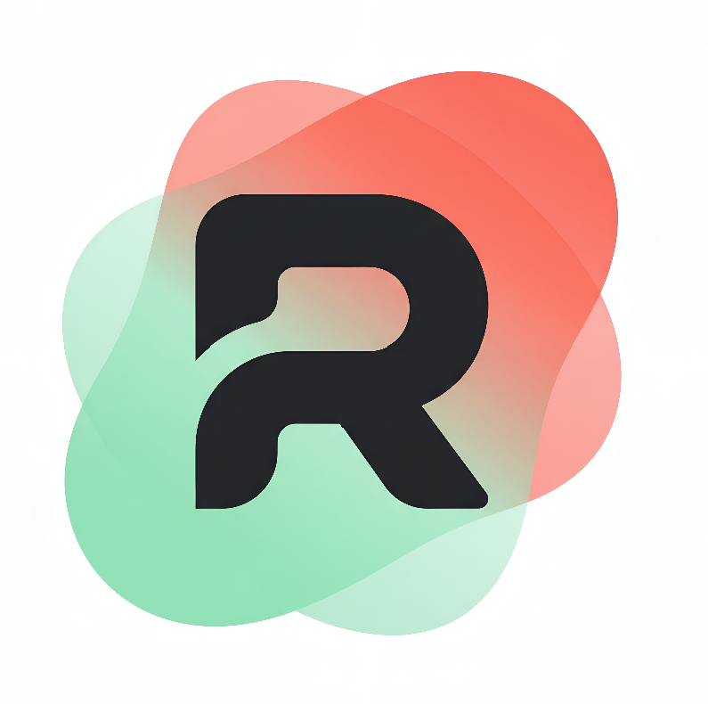

# RADIX — Premium Personal Finance Tracker

<p align="center">
  
</p>

<p align="center">
  <strong>A premium, minimalist, and highly responsive personal finance application built with Flutter.</strong>
</p>

<p align="center">
  
  
  
  
</p>

---

## Table of Contents

- [01. Introduction](#01-introduction)
- [02. The Motivation (Why I Built This)](#02-the-motivation-why-i-built-this)
- [03. Features & Engineering Highlights](#03-features--engineering-highlights)
- [04. Tech Stack & Key Libraries](#04-tech-stack--key-libraries)
- [05. Development Tools & AI Assistants](#05-development-tools--ai-assistants)
- [06. Project Architecture](#06-project-architecture)
- [07. Getting Started](#07-getting-started)
- [08. Retrospective & Key Learning Points](#08-retrospective--key-learning-points)
- [09. Special Thanks](#09-special-thanks)
- [10. Contribution & Feedback](#10-contribution--feedback)

---

## 01. Introduction

**RADIX** is an independent, offline personal finance tracker developed as an educational and experimental project. Built with Flutter, it features a **Crisp Apple Minimalist White** light mode and a **Luxury Dark Mode**, utilizing custom typography (`Monument Extended`, `Font Ultra`) and offline database capabilities.

This is my very first programming project. It was developed over a 5-week period between **June 8 and July 15** by a 16-year-old creator. While I co-piloted the development with AI (often called "vibe-coding"), I took complete ownership of the system design and architecture. I designed all layouts, conceptualized and implemented the animations, mapped the local SQLite database structures to the reactive UI layers (via ValueNotifiers/Providers), and implemented the mathematics for real-time currency conversions. 

---

## 02. The Motivation (Why I Built This)

The development of RADIX was inspired by three main factors:

- **Interest in Finance & AI:** I have a deep curiosity for financial systems, artificial intelligence, and building products. This project serves as a learning step to understand how they intersect in real-world applications.

- **Addressing the Youth "Money Leak" Problem:** I observed a prevalent social pattern among my peers and youth: the phenomenon of **"micro-spending creep"** or the **"money leak."** Young people frequently spend small, seemingly insignificant amounts on daily comforts—such as bubble tea, subscription services, gaming micro-transactions, or impulse snacks. Individually, these purchases feel negligible, but cumulatively, they create a silent leakage that drains their monthly allowance, preventing them from saving or understanding their actual cash flow. Most traditional budgeting apps are dry, clinical, and complex, which discourages teens from using them consistently. RADIX was built as a response to this: by combining a premium, responsive visual design with smooth micro-animations, I wanted to lower the friction of tracking and make financial awareness engaging. The dynamic budgeting indicators and instant visual analytics are engineered specifically to help young users identify where their money is leaking, helping them take control of their finances and build long-term financial literacy.

- **Childhood Dream & Business Mindset:** Since I was young, I dreamed of building and launching functional products. Developing RADIX at **16 years old** is my first step in learning product creation and business execution.

---

## 03. Features & Engineering Highlights

- **Reactive Daily Transaction Logger**
  - Instant logging of expenses and incomes.
  - Multi-attribute transactions including title, type, category, date, and currency mapping.

  - **Flexible Income Strategies:** Supports two distinct tracking logic strategies: `add_to_budget` (directly increases the monthly budget limit) and `deduct_from_spent` (cancels out or deducts from recorded spent amounts).
  - Quick-search filters and custom multi-sorting options (by Date, Amount, etc.) implemented on the database query layer.

- **Dynamic Currency Exchange & Conversion Math**
  - Supports switching active currencies (USD, EUR, CNY, VND, GBP, JPY, AUD, CAD) on-the-fly.
  - **Atomic Database Transactions:** Bulk conversion calculations for historical logs and monthly budgets run within a single, atomic SQLite transaction (`db.transaction`). This guarantees absolute database integrity and auto-rollback on failure.
  - Math formulation utilizes relative exchange rates to convert all database amounts dynamically and notify the UI layer reactively.

- **State-to-Database Bridging:** Synchronizes physical database records to the presentation layer reactively using a custom state structure powered by `ValueNotifier` and `InheritedWidget` wrappers (`ThemeProvider` and `CurrencyProvider`).
  - Real-time arithmetic tracking of:
    - `Remaining Budget = Monthly Budget - Total Expenses`
  - High-precision floating-point calculation to handle web and mobile platforms smoothly without rounding errors.

- **Performance-Optimized Charts & Analytics**
  - Visual financial analytics powered by `fl_chart` containing dynamic donut charts for category share distributions, premium category icons, featuring both total expense and specific expenses for categories.
  - **Memoization Cache:** Uses a custom transaction hashing algorithm to cache grouped transactions. It prevents redundant computation on every UI rebuild, achieving stable 60 FPS list scrolling.

- **Premium Visual Themes & Fine-tuned Animations**
  - **Crisp Apple Minimalist White** (Light) & **Luxury Dark** themes with centralized color schemes (`AppColorLocker`).
  - **Clockwise Sequential Loop Dot Loader:** A custom-designed, physics-tuned splash animation where money symbols move sequentially in a clockwise loop using sequential TweenSequences and curved animation controllers.
  - **Hold-to-Confirm Gesture (Settings Reset):** A 3-second continuous press gesture built with custom AnimationControllers that maps user duration to a circular scaling indicator, preventing accidental deletions.
  - **Fluid Page Route Transitions:** Custom slide and scale transitions for navigation, ensuring a polished, platform-native feel.

---

## 04. Tech Stack & Key Libraries

- **Framework:** [Flutter](https://flutter.dev/) (Dart)
- **Database:** [sqflite](https://pub.dev/packages/sqflite) (Native SQLite) & [sqflite_common_ffi_web](https://pub.dev/packages/sqflite_common_ffi_web) (IndexedDB + WebAssembly SQLite for Web compatibility).
- **Data Visualization:** [fl_chart](https://pub.dev/packages/fl_chart) for smooth and interactive charting.
- **Localization & Formatting:** [intl](https://pub.dev/packages/intl).
- **Fonts:** Custom typography with Google Fonts and Canva font assets (`MonumentExtended`, `FontUltra`).
  > ⚠️ **Font Note:** It is recommended to use **English** for all input fields. Other languages (e.g., Vietnamese, Chinese, Arabic) may not render correctly due to limited character support in the custom fonts (`MonumentExtended`, `FontUltra`).

---

## 05. Development Tools & AI Assistants

The development of RADIX was supported by a suite of modern coding tools and AI pair programmers:
- **VS Code:** The primary Integrated Development Environment (IDE) used for building, testing, and formatting the application.
- **Cline:** The AI assistant framework that facilitated code modifications, search, and development coordination.
- **Gemini:** The LLM intelligence powering complex problem-solving, code suggestions, prompt writing, and analytical reasoning.
- **Antigravity:** The specialized agent system that performed pairs-programming, lint fixes, and static analysis verification.

---

## 06. Project Architecture

```
lib/
├── database/
│   └── database_helper.dart      # Singleton class managing local SQLite DB / Web IndexedDB
├── models/
│   └── transaction_model.dart    # Transaction schema and model helpers
├── screens/
│   ├── splash_screen.dart        # Splash screen featuring custom sequential loading loops
│   ├── nav_wrapper.dart          # Base navigation layout wrapper
│   ├── home_screen.dart          # Main dashboard, transaction log, and budgeting allocation dialogs
│   ├── graph_screen.dart         # fl_chart analytics containing custom category donuts and bar charts
│   ├── settings_screen.dart      # Theme selection, dynamic currency converter, and hold-to-reset data dialogs
│   └── instruction_screen.dart   # Features walkthrough guide page
├── theme/
│   ├── app_theme.dart            # Theme configurations for Crisp Light and Luxury Dark mode
│   ├── app_color_locker.dart     # Central color registries (AppColorLocker, LightColorLocker, DarkColorLocker)
│   ├── theme_provider.dart       # State notifier wrapping ThemeMode changes
│   └── currency_provider.dart    # State notifier wrapping active CurrencyInfo changes
├── widgets/
│   └── transaction_tile.dart     # Custom list tile widget representing a transaction item
└── main.dart                     # Entry point initializing database configurations and state providers
```

---

## 07. Getting Started

### Try It Instantly

- **Direct Download (Android):** Download the pre-built [RADIX Android APK](https://github.com/ngoleminhphuc1011/RADIX-finance-tracker-app/releases/tag/v1.0.0) directly from the Releases page and install it on your device.
- **Web Demo (Not recommended for regular use):** Open the [Interactive Web Version](https://ngoleminhphuc1011.github.io/RADIX-finance-tracker-app/) in your browser for a quick preview. *(Note: The Web build is provided solely for demonstration purposes; for optimal performance, full offline capabilities, and design accuracy, please use the native Android or iOS builds).*

---

### Running Locally

Follow these steps to compile and run the project on your machine.

#### Prerequisites

- Ensure you have [Flutter SDK installed](https://docs.flutter.dev/get-started/install).
- A device, emulator, or browser configured for Flutter.

#### Installation & Launch

1. **Clone the repository:**
   ```bash
   git clone https://github.com/ngoleminhphuc1011/RADIX-finance-tracker-app.git
   cd RADIX-finance-tracker-app
   ```

2. **Get packages:**
   ```bash
   flutter pub get
   ```

3. **Run the application:**
   ```bash
   flutter run
   ```

---

## 08. Retrospective & Key Learning Points

As my first programming project, building RADIX was a wonderful learning experience. Developing this app alongside AI allowed me to learn rapidly, though it also highlighted areas for my growth as a creator:

1. **Learning to Code alongside AI ("Vibe-Coding"):**
   In the early days, my process was mostly "vibe-coding" — prompting and coding in tandem with AI tools without a concrete system plan. While this allowed me to prototype at an incredibly fast pace, it sometimes resulted in temporary bugs and code styling warnings. Learning to debug and standardize this code taught me the value of static analysis, compiler guidelines, and strict formatting rules.

2. **Evolving Code Organization:**
   To build quickly, I initially placed a lot of logic directly within single user interface files (causing screens like `home_screen.dart` to grow large). Refactoring this code taught me the value of componentization, breaking screens down into atomic, reusable widgets, and keeping code modular.

3. **Balancing Design & Core Logic:**
   I initially invested a lot of energy into polishing the micro-animations and custom transitions early on because I wanted the product to feel premium. However, this taught me the lesson of sequencing: I learned that establishing a solid database structure and core system logic must always be finalized before perfecting the design details.

---

## 09. Special Thanks

I would like to express my deepest gratitude to:
- **My Father & Family:** For constantly encouraging me to learn programming and being the motivation for me to build something meaningful that can bring positive value to our family, also I really want to give my family a better life. Thank you so much to Dad, Mom and my little sister. You are the reason why I keep going.
- **Alex Le:** A close friend who changed my mindset from planning to **real execution**, he also bring me to this finance and building mindset. Thanks bro!

---

## 10. Contribution & Feedback

This is my first personal project and was coded with AI assistance, so quite a few bugs are expected. I am very open to hearing both positive and negative suggestions, feedback, or feature requests! Please feel free to open an issue, submit a pull request, or share your thoughts.

Developed by **Fulton Ngo Corporation**.

---

### Credits

- **Idea by:** Phuc Ngo
- **Writing & Improvement by:** Gemini 3.5 Flash and Phuc Ngo
